# Aircraft Engine RUL Prediction

Predicting the remaining useful life (RUL), in flights, of 100 in-service aircraft engines from the run-to-retirement histories of 260 others. High-pressure compressor (HPC) degradation is the cause of retirement in every engine. This is Project 4 of the Industrial AI 2026 final project; the brief is in [`References/Project4_Engine_2026.pdf`](References/Project4_Engine_2026.pdf).

This README covers the data exploration, feature extraction, feature selection and dimensionality reduction done so far. RUL modeling is the next step.

## Repository layout

| Path | Contents |
|---|---|
| [`main.ipynb`](main.ipynb) | Data exploration and every plot below |
| [`features.ipynb`](features.ipynb) | Builds the 10-feature vector and saves it to `Features/` |
| `Features/` | Feature tables for the training, validation and test engines |
| `figures/` | The plots in this README, exported from `main.ipynb` |
| `TrainingData_Engine.csv` | The 260 training engines as one table, written by [`data1.m`](data1.m) from the `.mat` file |
| `Training_DataSet/`, `Testing_DataSet/` | Original MATLAB data files |
| `References/` | Project brief and background papers |
| `GroundTruth/` | True test RULs, not used anywhere in this work so that test results stay a fair evaluation |

## How to run

Requires Python 3 with pandas, NumPy, SciPy, scikit-learn, matplotlib and Jupyter. Developed with pandas 2.3, NumPy 2.3, SciPy 1.16, scikit-learn 1.7 and matplotlib 3.10.

```bash
pip install pandas numpy scipy scikit-learn matplotlib jupyter
```

Run `features.ipynb` first, then `main.ipynb`. Sections 9–11 of `main.ipynb` read the files that `features.ipynb` saves.

## Data

Each row is one flight: a snapshot of 24 measurements plus a label for the operating regime the flight was flown in.

### Raw readings

Air passes through the engine in this order, and the station numbers in the sensor names mark where each reading is taken:

**fan inlet (2) → low-pressure compressor (LPC, outlet 24) → high-pressure compressor (HPC, outlet 30) → burner → high-pressure turbine (HPT) → low-pressure turbine (LPT, outlet 50)**. Part of the fan's air bypasses the core through the bypass duct (15).

The **Status** column shows how each reading is used in this project, as explained in [Feature selection](#feature-selection).

**Operating settings:** describe the flight condition, not the engine.

| # | Name | Measurement | Unit | Status |
|---|---|---|---|---|
| 1 | Altitude | Flight altitude | thousand ft | Defines the regime |
| 2 | Mach # | Flight speed as a Mach number | – | Defines the regime |
| 3 | Power Setting (TRA) | Throttle setting (throttle resolver angle) | – | Defines the regime |

**Temperatures**

| # | Name | Measurement | Unit | Status |
|---|---|---|---|---|
| 4 | T2 | Total temperature at fan inlet | °R | Constant within a regime |
| 5 | T24 | Total temperature at LPC outlet | °R | **Selected** |
| 6 | T30 | Total temperature at HPC outlet | °R | **Selected** |
| 7 | T50 | Total temperature at LPT outlet | °R | **Selected** |

**Pressures**

| # | Name | Measurement | Unit | Status |
|---|---|---|---|---|
| 8 | P2 | Pressure at fan inlet | psia | Constant within a regime |
| 9 | P15 | Total pressure in bypass duct | psia | Weak trend |
| 10 | P30 | Total pressure at HPC outlet | psia | Trends with wear, below cut-off |
| 13 | epr | Engine pressure ratio (P50/P2) | – | Almost no trend |
| 14 | Ps30 | Static pressure at HPC outlet | psia | **Selected** |

**Shaft speeds**

| # | Name | Measurement | Unit | Status |
|---|---|---|---|---|
| 11 | Nf | Physical fan speed | rpm | Excluded: inconsistent across engines |
| 12 | Nc | Physical core speed | rpm | Excluded: inconsistent across engines |
| 16 | NRf | Corrected fan speed | rpm | Excluded: inconsistent across engines |
| 17 | NRc | Corrected core speed | rpm | Excluded: inconsistent across engines |
| 21 | Nf_dmd | Demanded fan speed | rpm | Constant within a regime |
| 22 | PCNfR_dmd | Demanded corrected fan speed | rpm | Constant within a regime |

**Ratios, flows and bleed**

| # | Name | Measurement | Unit | Status |
|---|---|---|---|---|
| 15 | phi | Ratio of fuel flow to Ps30 | pps/psi | Trends with wear, below cut-off |
| 18 | BPR | Bypass ratio | – | **Selected** |
| 19 | farB | Burner fuel-air ratio | – | Weak trend |
| 20 | htBleed | Bleed enthalpy | – | **Selected** |
| 23 | W31 | HPT coolant bleed | lbm/s | Trends with wear, below cut-off |
| 24 | W32 | LPT coolant bleed | lbm/s | Trends with wear, below cut-off |

`#` is the column order in the original data files. Units are as given in the project brief, except altitude, which the brief leaves unlabeled; its values (0–42) match thousands of feet. °R is degrees Rankine, psia is pounds per square inch absolute, pps is pounds per second, and "–" means dimensionless or not stated.

### Operating regimes

Each flight carries a regime label from 1 to 6, set by the three operating settings. Within a regime, each setting varies by 0.01 or less.

| Regime | Altitude (thousand ft) | Mach | Power setting (TRA) | Share of training flights |
|---|---|---|---|---|
| 1 | 0 | 0.00 | 100 | 15% |
| 2 | 10 | 0.25 | 100 | 15% |
| 3 | 20 | 0.70 | 100 | 15% |
| 4 | 25 | 0.62 | 60 | 15% |
| 5 | 35 | 0.84 | 100 | 15% |
| 6 | 42 | 0.84 | 100 | 25% |

The regime mix is the same early and late in life, so the regime says nothing about wear on its own.

### Engines

- **Training:** 260 engines, 53,759 flights, each running from new to retirement after 128–378 flights (median 199).
- **Test:** 100 engines, stopped at 21–367 flights, still in service.

Test engines are younger on average than the training engines: 51 of the 100 have flown no more than the shortest training life of 128 flights.

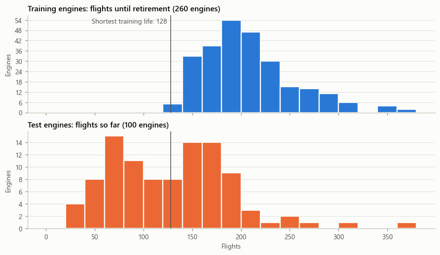

## Feature extraction

### Regime normalization

The operating regime dominates every sensor reading. Regime explains over 96% of the variance in every sensor except `farB` (89%), and consecutive flights switch regime 83% of the time, so a raw sensor trace is a sawtooth that hides any wear trend.

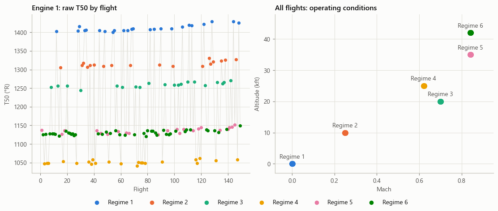

Each sensor is therefore z-scored within its regime against a healthy baseline: the mean and standard deviation of each engine's first 30 flights. After normalization, a value of 0 means "typical of a new engine in this regime".

Four sensors (`T2`, `P2`, `Nf_dmd`, `PCNfR_dmd`) are constant within every regime, so they carry no information once the regime is known.

### Sensor trends approaching retirement

Each panel shows one normalized sensor for every training engine, smoothed over 15 flights and aligned at retirement (flight 0). The blue line is the fleet median and the band the middle 50% of engines.

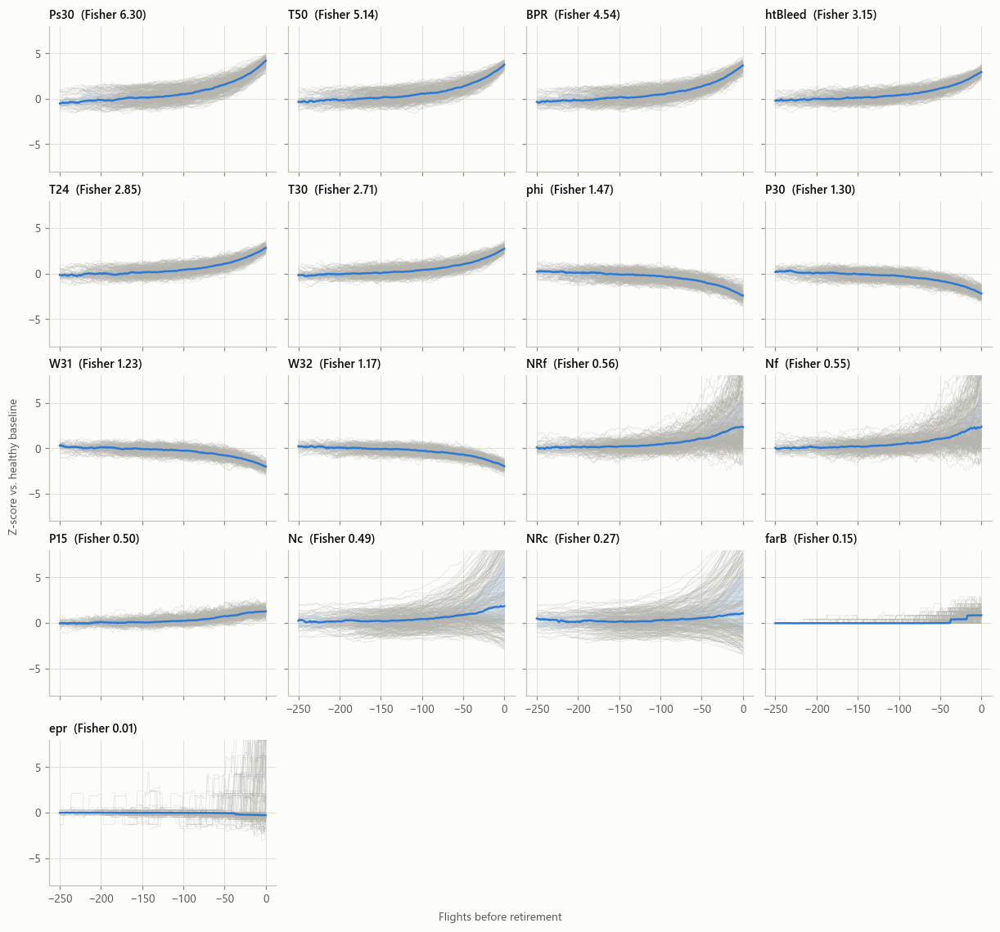

The strongest sensors rise smoothly and consistently toward retirement. The speed sensors (`Nf`, `NRf`, `Nc`, `NRc`) fan out widely, and `epr` and `farB` barely move.

## Feature selection

### Fisher criterion

The Fisher score measures how well a sensor separates each engine's first 30 flights (healthy) from its last 30 flights (degraded), relative to the spread within each group. Sensors scoring 2 or more were kept.

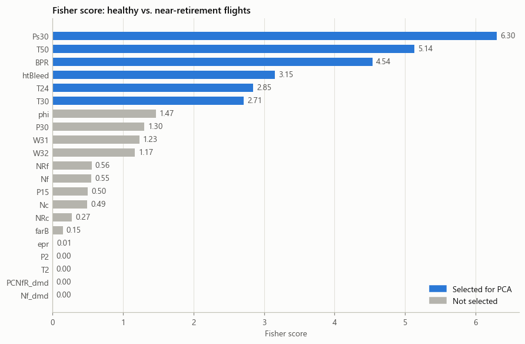

### Consistency across engines

A good degradation signal should move the same way on every engine. Each box shows the per-engine Spearman correlation between a sensor and flight number.

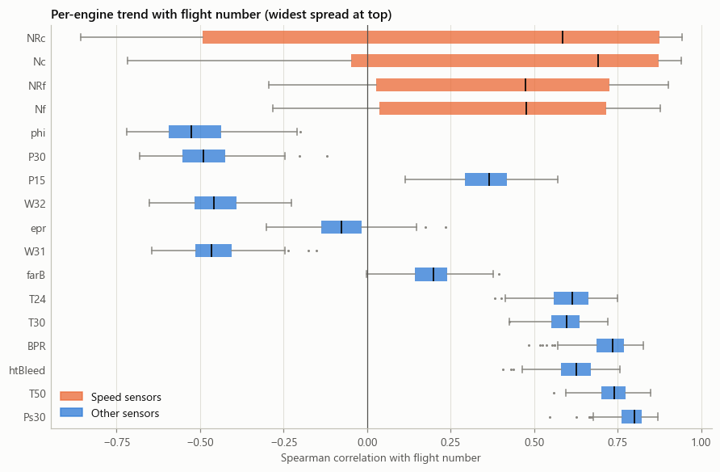

The speed sensors are the least consistent: `Nc`, for example, clearly rises on 63% of engines and falls on 17%. They are excluded even though their trend correlates with engine life, because including them in PCA widened the smoothed indicator's spread at retirement from 0.48 to 6.35 (standard deviation across engines).

### Redundancy

The physical and corrected speeds are near duplicates (`Nf`/`NRf` r = 0.96, `Nc`/`NRc` r = 0.94). The six selected sensors form one correlated block.

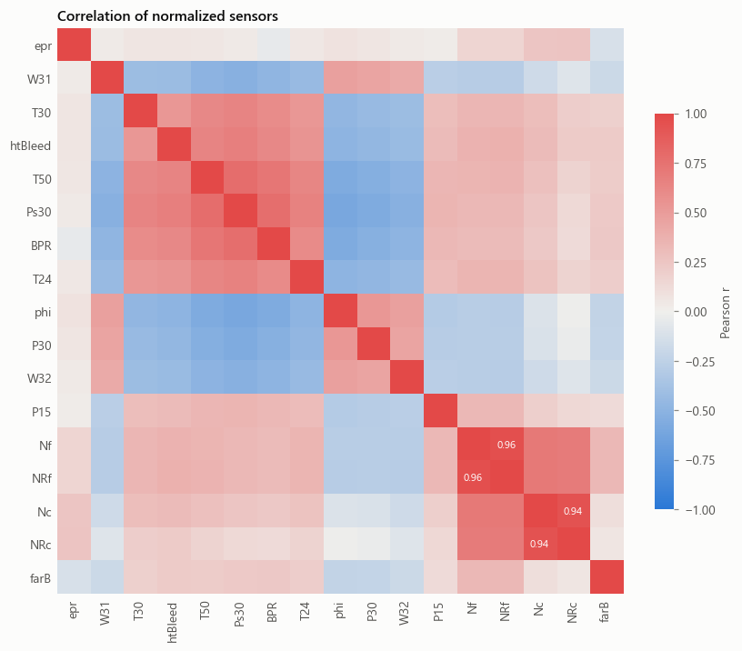

**Selected sensors:** `Ps30`, `T50`, `BPR`, `htBleed`, `T24`, `T30`.

## Dimensionality reduction

PCA on the raw data finds the operating regimes: raw PC1 holds 80% of the variance, 99.9% of which is explained by regime, and its correlation with RUL is only −0.12. On the six normalized sensors, PC1 follows wear instead, with a correlation of −0.77.

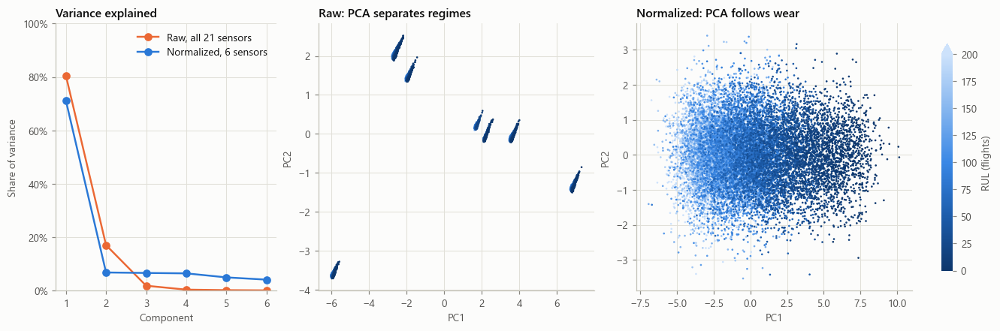

Principal components of the six selected sensors, fitted on the 208 training engines (from `features.ipynb`):

| | Variance | Cumulative | Ps30 | T50 | BPR | htBleed | T24 | T30 |
|---|---|---|---|---|---|---|---|---|
| **PC1** | 71.0% | 71.0% | 0.494 | 0.443 | 0.444 | 0.361 | 0.348 | 0.334 |
| PC2 | 6.8% | 77.8% | −0.043 | −0.050 | −0.088 | −0.454 | −0.130 | 0.874 |
| PC3 | 6.6% | 84.5% | −0.061 | −0.049 | −0.184 | −0.397 | 0.890 | −0.098 |
| PC4 | 6.5% | 90.9% | −0.204 | −0.186 | −0.549 | 0.693 | 0.206 | 0.315 |
| PC5 | 5.0% | 95.9% | 0.142 | 0.753 | −0.601 | −0.140 | −0.147 | −0.105 |
| PC6 | 4.1% | 100.0% | 0.830 | −0.444 | −0.315 | −0.073 | −0.072 | −0.065 |

PC1 is the only component that combines all six sensors, so it is used as the health indicator, oriented so that higher means more degraded. PC2–PC6 each centre on one or two sensors and mostly capture individual sensor variation; their signs are arbitrary.

### PC1 as a health indicator

Smoothed PC1 follows the same accelerating shape as Figure 1 of the project brief. Engines start at quite different levels (−2.26 ± 1.44 at flight 15) but retire at a consistent one (6.05 ± 0.48).

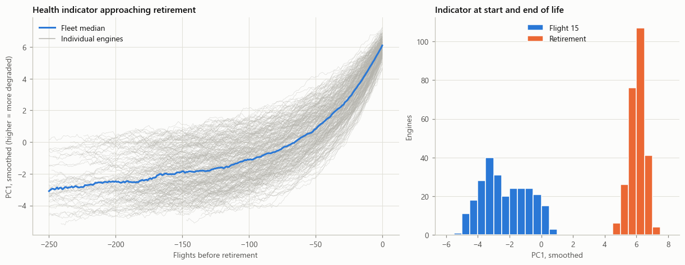

## Feature vector

`features.ipynb` builds one row per flight, from flight 20 onward. Every fitted step (regime baseline, Fisher selection, PCA) uses only the 208 training engines and is then applied unchanged to 52 held-out validation engines and the 100 test engines. Every feature uses only the current and earlier flights, which is checked by truncating engines and confirming their feature rows are unchanged.

| Feature | Definition | Spearman with RUL (validation) |
|---|---|---|
| `Ps30`, `T50`, `BPR`, `htBleed`, `T24`, `T30` | Regime-normalized sensor, averaged over the last 15 flights | −0.76 to −0.77 |
| `health` | PC1 averaged over the last 15 flights | −0.78 |
| `health_delta` | `health` minus the engine's mean PC1 over its first 20 flights | −0.88 |
| `health_slope` | Linear slope of PC1 over the last 20 flights | −0.67 |
| `Cycle` | Flights flown so far | −0.69 |

| Set | Engines | Rows |
|---|---|---|
| Training | 208 | 38,860 |
| Validation | 52 | 9,959 |
| Test | 100 | 100 (each engine's last flight) |

The window lengths are starting choices, not tuned values. The 20-flight windows are set by the shortest test engine, which has 21 flights.

### Features by engine

The shortest, median and longest-lived training engines:

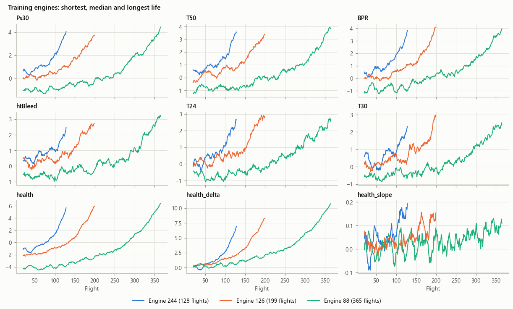

The same for the validation engines, which played no part in any fitting:

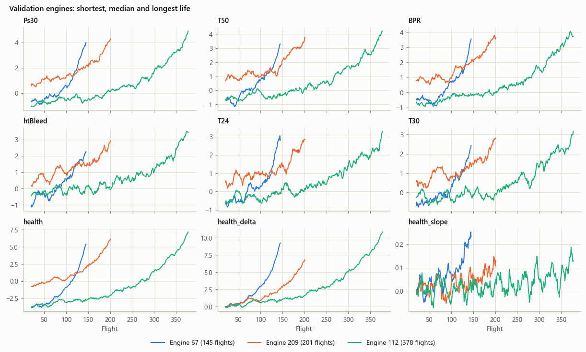

And for the test engines with the fewest, median and most flights so far:

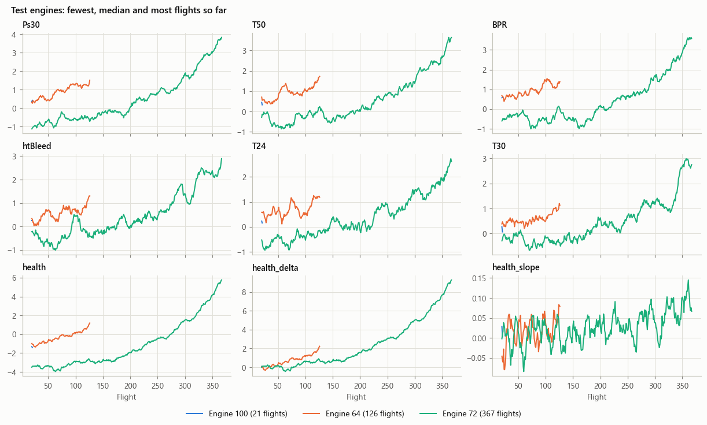

### Derived features across the fleet

`health_delta` removes each engine's starting level, which tightens the fleet considerably compared with `health`. `health_slope` trends upward but is noisy from flight to flight.

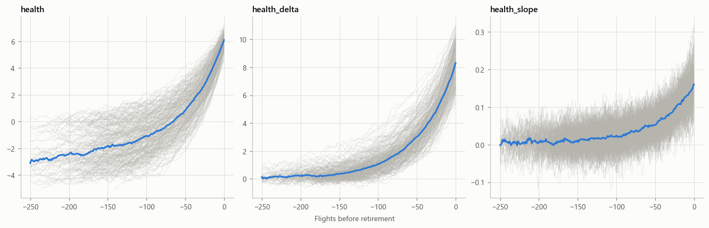

### Where the test engines sit

Each test engine at its last flight, against the training and validation fleet at the same flight count. Young test engines cluster near zero, which leaves little to distinguish them; engines at 130–200 flights range from almost new to near retirement.

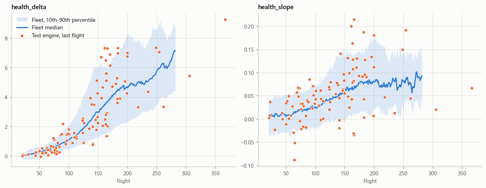

## Notes on the analysis

- Sections 1–8 of `main.ipynb` fit on all 260 training engines as exploration. Results for modeling come from `features.ipynb`, which fits on training engines only.
- The healthy baseline assumes each engine's first 30 flights are undamaged. Normalized sensor medians stay near 0 over flights 1–30 and drift only afterwards, which supports this.

## Next steps

1. Trajectory similarity RUL prediction on the `health` indicator, evaluated on validation engines cut at random points across the test range (21–367 flights).
2. A logistic regression health indicator trained on healthy vs. degraded flights, compared against PC1.
3. An exponential curve fit as a cross-check.
4. An LSTM on the normalized sensor sequences, kept only if it beats trajectory similarity.
